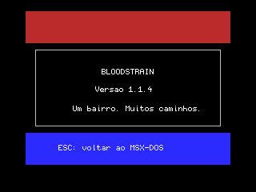

# Bloodstrain

**Um bairro. Muitos caminhos.**

Adventure de ação com elementos de RPG para **MSX2 / MSX-DOS 2**, ambientado em um único bairro de São Paulo. Exploração, relações com facções, escolhas e um pet que evolui com o protagonista são o centro da proposta.

> **Estado atual: fundação técnica, versão 1.1.4.** A execução mostra apenas uma abertura colorida com o nome do jogo e permite retornar ao DOS com ESC. Não há gameplay, sprites próprios ou áudio nesta versão. A fundação foi numerada 1.1.1 por escolha do criador; os patches seguintes corrigiram a saída ao DOS e reforçaram as ferramentas e testes. Esses números não significam que a campanha esteja pronta.

## O jogo que queremos construir

- Protagonista escolhido entre **três classes**.
- **Pet com atributos e evolução**, não apenas um acompanhante decorativo.
- Inventário limitado, exploração e elementos de adventure.
- Facções amigas e inimigas e uma pessoa que se tornará uma aliada importante.
- Dois ou três tipos de zumbis e um inimigo como chefe final.
- Sete ou oito pontos principais no bairro, com backtracking.
- Poucos inimigos simultâneos; muitos diálogos, caminhos e consequências.

### Roteiro — premissa confirmada

A história se passa em um bairro de São Paulo, com presença de zumbis e facções. O protagonista e seu pet atravessam locais que poderão ser revisitados, interagem com aliados e adversários e seguem caminhos diferentes até o confronto com um chefe final.

**Ainda não registrado:** nome do bairro, causa da crise, classes, identidade da aliada e do chefe, objetivos, eventos e finais. O criador já possui ideias e roteiro, mas eles ainda não foram transcritos para o projeto. Não preencher essas lacunas como se fossem decisões aprovadas.

O roteiro detalhado ficará em [docs/story](docs/story/). Este resumo será atualizado a partir das decisões aprovadas, evitando spoilers desnecessários no material para jogadores.

## Comece por aqui

| Documento | Finalidade |
|---|---|
| [kickstart.md](kickstart.md) | Pergunta original e avaliação inicial de viabilidade. |
| [OUTLINE.md](OUTLINE.md) | Estado vivo, decisões, próximos passos, pendências e bugs. **Leia antes de trabalhar.** |
| [MANUAL.md](MANUAL.md) | Instalação, execução, controles e limitações para o jogador. |
| [CHANGELOG.md](CHANGELOG.md) | Resumo das mudanças para usuários. |
| [RELEASE.md](RELEASE.md) | Política X.Y.Z, apelidos, detalhes e checklist de releases. |
| [THIRD_PARTY.md](THIRD_PARTY.md) | Créditos e licenças de dependências. |
| [LICENSE](LICENSE) | GNU GPL versão 3. |

## Plataforma

| Item | Alvo do projeto |
|---|---|
| Computador | MSX2, Z80, V9938 ou compatível |
| Sistema | MSX-DOS 2 |
| RAM | Máquina de referência com 512 KiB; uso do mapper ainda não implementado |
| Vídeo atual | SCREEN 5, área desenhada de 256 × 192; modo de 212 linhas a avaliar |
| Áudio planejado | SCC / MSX-Music (FM) e PSG; nenhum exigido pela abertura |
| Desenvolvimento | C, SDCC e MSXgl; scripts Windows PowerShell |

A capacidade de VRAM da máquina real ainda precisa ser confirmada. O jogo completo será orçado depois da primeira fatia jogável.

## Compilar e empacotar

No Windows, use um caminho **sem espaços** e mantenha as dependências completas na raiz:

```text
bloodstrain\
  MSXgl\
  msxDiskUtil\
  src\
  scripts\
  ...
```

```powershell
.\scripts\setup.ps1
.\build.bat
```

Ou execute a tarefa **Bloodstrain: build e pacote** no Visual Studio Code. O script usa o Node e o SDCC da MSXgl, compila os módulos, monta o startup Z80, liga, converte IHX para COM, cria um DSK com msxDiskUtil e gera o ZIP.

Para também validar a execução com openMSX e capturar screenshots, forneça sua mídia de sistema local:

```powershell
.\build.bat -SmokeTest -DosFilesPath .\MSXgl\tools\build\DOS -BootTemplatePath .\msxDiskUtil\msxdos.dsk
```

Esse teste usa Philips NMS 8255, cartucho DOS 2 e mapper externo de 512 KiB; requer as ROMs no seu openMSX. Cria um disco de sistema privado temporário e o remove ao terminar. Seus arquivos de DOS nunca entram no pacote do jogo.

Cada nova compilação **concluída com sucesso pelo pipeline** aumenta Z em [version.json](version.json). O release fundador 1.1.1 foi gerado com `.\build.bat -InitialRelease`; não use essa opção para recompilar uma versão já publicada. Consulte [RELEASE.md](RELEASE.md) para mudar X ou Y.

Saídas:

```text
dist\
  Bloodstrain-X.Y.Z\
    BLOODSTR.COM
    Bloodstrain-X.Y.Z.dsk
    README.md, MANUAL.md, LICENSE, CHANGELOG.md, RELEASE.md
    THIRD_PARTY.md, OUTLINE.md, kickstart.md, licenses\
    docs\, version.json, SHA256SUMS.txt
    SOURCE.zip
  Bloodstrain-X.Y.Z.zip
```

**O DSK é um disco de dados, não um disco de boot.** Não contém MSXDOS2.SYS nem COMMAND2.COM. Inicie seu próprio MSX-DOS 2 e execute `BLOODSTR` a partir da unidade do jogo. Veja o [manual](MANUAL.md).

O ZIP contém os fontes correspondentes do jogo e da biblioteca vinculada em `SOURCE.zip`. Para reconstruir esses fontes, restaure as ferramentas da distribuição MSXgl; compiladores e ROMs de emulador não são redistribuídos no pacote.

## Organização

| Pasta | Conteúdo |
|---|---|
| [src](src/) e [include](include/) | Código C e interfaces; módulos de core, mundo, atores, sistemas, áudio e UI. |
| [assets](assets/) | Originais editáveis e exportações de arte e áudio. |
| [data](data/) | Dados de mapas, diálogos, classes, pet, itens e facções. |
| [docs](docs/) | Roteiro e screenshots reais. |
| [scripts](scripts/) | Preparação, build, empacotamento e verificação. |
| [tests](tests/) | Documentação de testes e futuros testes automatizados. |
| `build` e `dist` | Intermediários e releases gerados; não são fontes. |
| [MSXgl](MSXgl/) e [msxDiskUtil](msxDiskUtil/) | Dependências externas; não alterar para corrigir o jogo. |

## Screenshots



Captura real no openMSX 21.0, Philips NMS 8255, V9938/128 KiB de VRAM, mapper externo de 512 KiB e cartucho DOS 2. Veja [os registros de captura](docs/screenshots/README.md). A screenshot não comprova funcionamento em hardware físico.

## Créditos

- **Conceito, roteiro e direção:** criador de Bloodstrain, identificado nesta sessão como Barney; nome de crédito público a confirmar.
- **Assistência de desenvolvimento e documentação:** AI assistant using Copilot SDK in VS Code. Contribuições assistidas devem ser revisadas pelo responsável humano.
- **MSXgl:** Guillaume “Aoineko” Blanchard e colaboradores; biblioteca, template MSX2 e fonte `font_mgl_sample6`, sob CC BY-SA 4.0. [Projeto](https://github.com/aoineko-fr/MSXgl).
- **SDCC:** equipe e colaboradores do Small Device C Compiler. [Projeto](https://sdcc.sourceforge.net/).
- **Visual Studio Code:** Microsoft e colaboradores. [Projeto](https://code.visualstudio.com/).
- **msxDiskUtil:** Arnold Metselaar (utilitários originais); Wilson “Barney” Pilon (adaptação e projeto atual). A versão local é uma reescrita em PureBasic, GPLv3; ver [documentação da ferramenta](msxDiskUtil/README.md).
- **openMSX:** equipe e colaboradores, emulador para validação. [Projeto](https://openmsx.org/).
- **Arte e áudio próprios:** ainda não produzidos; registrar autoria e origem quando forem adicionados.

Nomes de lugares ou personagens usados como apelidos de releases são referências culturais, não indicação de vínculo ou endosso. Não serão reutilizadas músicas, imagens, logotipos ou textos dessas obras.

## Licença

As contribuições originais de Bloodstrain são disponibilizadas sob **GPL-3.0-only**, sem garantia. Dependências e recursos de terceiros preservam suas próprias licenças e atribuições. Consulte [LICENSE](LICENSE) e [THIRD_PARTY.md](THIRD_PARTY.md).
