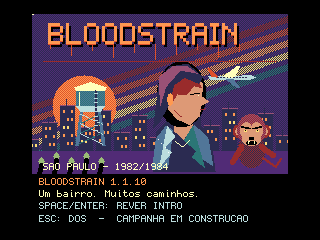
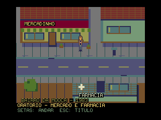
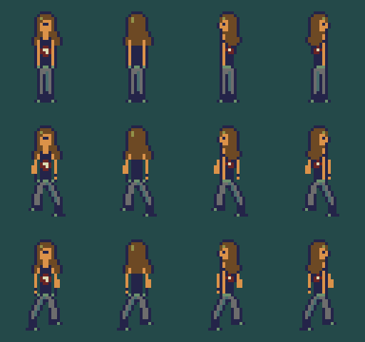
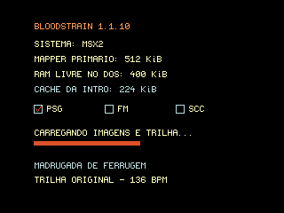

# Bloodstrain

**Um bairro. Muitos caminhos.**



**1.1.17 — Alexandria — Fundações e abertura**  
Linha 1: **Raccoon City**. Patch do ciclo Alexandria, sem novo apelido.

[Último release público: 1.1.17](https://github.com/wilsonpilon/bloodstrain/releases/tag/v1.1.17)
· [Manual do jogo](MANUAL.md) · [Notas da versão](RELEASE.md#1117--2026-10-15)

Adventure de ação com elementos de RPG para **MSX2 / MSX-DOS 2**, ambientado em um único bairro de São Paulo. Exploração, relações com facções, escolhas e um pet que evolui com o protagonista são o centro da proposta.

> **Estado atual: abertura narrativa e protótipo de exploração, versão 1.1.17.** Tela ilustrada de
> título e seis quadros alternados com cartões de texto, arte original e avanço manual.
> Imagens comprimidas com ZX0 e carregadas uma vez na RAM mapper.
> Trilha original PSG com camadas opcionais FM/SCC e diagnóstico na carga.
> SPACE/ENTER avança, S pula ao título e ESC retorna ao DOS.
> **M** abre o teste da quadra; **setas** movimentam e **ESC** volta ao título.
> Ainda não há campanha, combate, interações ou inventário.
> A numeração não significa que a campanha esteja pronta.

## Jogar esta versão

1. Baixe e extraia `Bloodstrain-1.1.17.zip` no release acima.
2. Inicie seu MSX-DOS 2 e mantenha `BLOODSTR.COM`, `INTRO.PAK` e `WORLD.PAK` juntos.
3. Execute `BLOODSTR`. **SPACE/ENTER** inicia e avança a introdução;
   **S** volta ao título e **ESC** retorna ao DOS.

O DSK público contém somente o jogo, **sem DOS2 e sem boot automático**.
A versão 1.1.17 permite ver e rever a introdução e explorar o mapa abaixo
pressionando **M** no título. O disco privado `temp\bloodstrain-current.dsk`
recebe a mesma versão, com DOS2 e boot automático somente para testes locais.

### Primeira quadra explorável



Cinco telas fixas em visão superior: acesso à Rua Criciumal, quadra do mercado
com a farmácia em frente, viela em direção ao teatro, interior do mercado e
interior da farmácia. A saída leste aponta para a delegacia; os caminhos ainda
não construídos são sinalizados e não há passagem ao sul.

Arte original de um bairro ficcional bem cuidado no início dos anos 1980,
SCREEN 5 com 192 linhas de cenário e 20 de interface, protagonista provisória
com repouso e duas passadas por direção, obstáculos sólidos e portas conectadas.
O mercado também é acessível pela viela. Os sprites servem para testar escala,
movimento e colisão, não são a arte final.

Na 1.1.13, a protagonista ganha um desenho original de **16 × 24 pixels**:
cabelos castanhos até os ombros, óculos, jaqueta escura com detalhes metálicos,
jeans e botas, inspirado na referência visual fornecida pelo criador.
Frente, costas e perfis têm duas fases de caminhada. A silhueta mais alta
não muda a colisão pelos pés nem as portas.

Na 1.1.14, a cabeça e o rosto ficam menores, com ombros mais estreitos,
cintura marcada e pernas mais longas, mantendo 16 × 24 pixels. A caminhada
alterna repouso, passada esquerda, repouso e passada direita, com braços
acompanhando o movimento. O ciclo segue a distância percorrida, não a taxa
de vídeo; ao parar ou esbarrar, ela volta à pose neutra.

Na 1.1.15, a nova referência orienta um desenho de **16 × 32 pixels**:
camiseta preta com estampa vermelha/clara, braços à mostra, pulseiras,
jeans cinza, botas e cabelo castanho solto. A jaqueta foi retirada.
O desenho adapta a referência à exploração superior, sem acrescentar
corrida, salto ou ataques. O sprite mantém quatro direções e caminhada.

Na 1.1.16, os braços alternam avanço e recuo de forma mais visível,
acompanhando as passadas nas quatro direções, sem mudar o visual aprovado.

A protagonista usa oito sprites em dois blocos verticais, **quatro por linha**.
O V9938 permite oito por linha: restam quatro para outros atores na mesma
altura, não quatro personagens completos. Padrões compartilhados e comprimidos
ZX0 preservam espaço no executável; a descompressão ocorre só ao abrir o mapa.
Não muda a paleta do cenário nem a pegada de colisão.



Na 1.1.12, a quadra deixa os tons pastel: concreto e asfalto frios, verdes
fechados, telhados vinho/ferrugem e pequenos destaques amarelados. Sombras
sob fachadas e prateleiras dão um clima mais sombrio sem arruinar o bairro
ou esconder a personagem, as portas e as indicações.

O teste começa na rua somente para desenvolver a navegação. **A campanha
começará no quarto da protagonista.** A trilha permanece exclusiva à abertura;
o mapa está sem música nesta etapa. Cada troca de área lê e descomprime sua
imagem de `WORLD.PAK` (2.787 bytes para as cinco telas), sem reservar outro
cache mapper.

## O jogo que queremos construir

- Protagonista escolhido entre **três classes**.
- **Pet com atributos e evolução**, não apenas um acompanhante decorativo.
- Inventário limitado, exploração e elementos de adventure.
- Facções amigas e inimigas e uma pessoa que se tornará uma aliada importante.
- Dois ou três tipos de zumbis e um inimigo como chefe final.
- Sete ou oito pontos principais no bairro, com backtracking.
- Poucos inimigos simultâneos; muitos diálogos, caminhos e consequências.

### Roteiro — premissa confirmada

A história se passa na Mooca, em uma São Paulo ficcional entre 1982 e 1984.
Uma viajante retorna do Sudeste Asiático após uma mordida; uma falha nas obras
do hospital leva a contaminação à água do bairro. Alheia ao surto, uma jovem
metaleira que joga Atari e programa em seu MSX1 se prepara para ir ao mercado.

**Ainda não registrado:** classes, identidade da aliada e do chefe, regras do
pet, objetivos posteriores à ida ao mercado e finais. Não preencher essas
lacunas como se fossem decisões aprovadas.

A introdução revisada e o storyboard estão em [docs/roteiro.md](docs/roteiro.md);
o [TXT original](docs/roteiro.txt) foi preservado. As instituições e o acidente
são elementos ficcionais, não relatos de ocorrências reais.

## Comece por aqui

| Documento | Finalidade |
|---|---|
| [kickstart.md](kickstart.md) | Pergunta original e avaliação inicial de viabilidade. |
| [OUTLINE.md](OUTLINE.md) | Estado vivo, decisões, próximos passos, pendências e bugs. **Leia antes de trabalhar.** |
| [MANUAL.md](MANUAL.md) | Instalação, execução, controles e limitações para o jogador. |
| [CHANGELOG.md](CHANGELOG.md) | Resumo das mudanças para usuários. |
| [RELEASE.md](RELEASE.md) | Política X.Y.Z, apelidos, detalhes e checklist de releases. |
| [THIRD_PARTY.md](THIRD_PARTY.md) | Créditos e licenças de dependências. |
| [LICENSE](LICENSE) | GNU GPL versão 3. |

## Plataforma

| Item | Alvo do projeto |
|---|---|
| Computador | MSX2, Z80, V9938 ou compatível |
| Sistema | MSX-DOS 2 |
| RAM | 512 KiB mapper; introdução reserva 224 KiB livres no mapper principal |
| Vídeo atual | SCREEN 5, 256 × 212, 16 cores de paleta própria |
| Áudio atual | PSG; MSX-Music/YM2413 (FM) e SCC detectados e usados como camadas opcionais |
| Desenvolvimento | C, SDCC e MSXgl; scripts Windows PowerShell |

A capacidade de VRAM da máquina real ainda precisa ser confirmada. O jogo completo será orçado depois da primeira fatia jogável.

## Compilar e empacotar

No Windows, use um caminho **sem espaços** e mantenha as dependências completas na raiz:

```text
bloodstrain\
  MSXgl\
  msxDiskUtil\
  src\
  scripts\
  ...
```

```powershell
.\scripts\setup.ps1
.\build.bat
```

Ou execute a tarefa **Bloodstrain: build e pacote** no Visual Studio Code. O script usa o Node e o SDCC da MSXgl, gera as ilustrações, compila os módulos,
monta o startup Z80, liga, converte IHX para COM, cria um DSK com msxDiskUtil e
gera o ZIP.

Para também validar a execução com openMSX e capturar screenshots, forneça sua mídia de sistema local:

```powershell
.\build.bat -SmokeTest -DosFilesPath .\MSXgl\tools\build\DOS -BootTemplatePath .\msxDiskUtil\msxdos.dsk
```

Esse teste usa Philips NMS 8255, cartucho DOS 2 e mapper externo de 512 KiB; requer as ROMs no seu openMSX. Cria um disco de sistema privado temporário e o remove ao terminar. Seus arquivos de DOS nunca entram no pacote do jogo.

Cada nova compilação **concluída com sucesso pelo pipeline** aumenta Z em [version.json](version.json). O release fundador 1.1.1 foi gerado com `.\build.bat -InitialRelease`; não use essa opção para recompilar uma versão já publicada. Consulte [RELEASE.md](RELEASE.md) para mudar X ou Y.

Saídas:

```text
dist\
  Bloodstrain-X.Y.Z\
    BLOODSTR.COM
    INTRO.PAK
    WORLD.PAK
    Bloodstrain-X.Y.Z.dsk
    README.md, MANUAL.md, LICENSE, CHANGELOG.md, RELEASE.md
    THIRD_PARTY.md, OUTLINE.md, kickstart.md, licenses\
    docs\, version.json, SHA256SUMS.txt
    SOURCE.zip
  Bloodstrain-X.Y.Z.zip
```

**O DSK é um disco de dados, não um disco de boot.** Não contém MSXDOS2.SYS nem COMMAND2.COM. Inicie seu próprio MSX-DOS 2 e execute `BLOODSTR` a partir da unidade do jogo. Veja o [manual](MANUAL.md).

Mantenha o COM e `INTRO.PAK` da mesma versão na mesma pasta e execute o jogo
a partir dela. O pacote comprimido ocupa 20.546 bytes, contra 189.952 bytes
dos sete SC5 anteriores (89,2% menos). A carga e a descompressão acontecem uma
vez; as imagens ficam em 14 segmentos DOS2 de 16 KiB, sem releitura do disco
nas transições ou no replay. Não exige FM nem SCC.

A trilha original **Madrugada de Ferrugem** combina riffs de heavy metal e
clima de terror B dos anos 1980: 136 BPM, 32 compassos, loop de aproximadamente
56 segundos. PSG toca baixo, melodia e bateria sintetizada; FM acrescenta
guitarras em quintas e cordas, SCC acrescenta timbres ásperos e uma voz aguda.
Começa somente após a pré-carga, continua entre título, ilustrações e cartões,
e é silenciada ao sair. Não há arquivo musical externo: partitura e instrumentos
estão no COM. O andamento é ajustado para vídeo de 50/60 Hz.

Na 1.1.9, o arranjo ganha bumbo duplo, guitarra FM original com alto feedback
e riffs SCC graves com onda saturada e articulação curta.

A tela de carga mostra a geração do MSX, capacidade e RAM livre do mapper
principal antes da reserva do cache, e caixas com tique para PSG, FM e SCC.
PSG é padrão obrigatório do MSX; FM significa MSX-Music/YM2413 (não MSX-Audio).

O ZIP contém os fontes correspondentes do jogo e da biblioteca vinculada em `SOURCE.zip`. Para reconstruir esses fontes, restaure as ferramentas da distribuição MSXgl; compiladores e ROMs de emulador não são redistribuídos no pacote.

## Organização

| Pasta | Conteúdo |
|---|---|
| [src](src/) e [include](include/) | Código C e interfaces; módulos de core, mundo, atores, sistemas, áudio e UI. |
| [assets](assets/) | Originais editáveis e exportações de arte e áudio. |
| [data](data/) | Dados de mapas, diálogos, classes, pet, itens e facções. |
| [docs](docs/) | Roteiro e screenshots reais. |
| [scripts](scripts/) | Preparação, build, empacotamento e verificação. |
| [tests](tests/) | Documentação de testes e futuros testes automatizados. |
| `build` e `dist` | Intermediários e releases gerados; não são fontes. |
| [MSXgl](MSXgl/) e [msxDiskUtil](msxDiskUtil/) | Dependências externas; não alterar para corrigir o jogo. |

## Screenshots



O destaque no topo é a tela de título, também exibida ao terminar a introdução.
Capturas reais da versão 1.1.10 no openMSX 21.0, Philips NMS 8255, DOS2 e mapper
externo de 512 KiB. O [storyboard completo](assets/art/export/storyboard.png)
mostra as seis cenas e o título, como prévia gerada, não screenshot.
O smoke test salva as ilustrações e os cartões reais em `build/smoke`.
Veja [os registros de captura](docs/screenshots/). Testes em emulador não
comprovam funcionamento em hardware físico.

## Créditos

- **Conceito, roteiro e direção:** criador de Bloodstrain, identificado nesta sessão como Barney; nome de crédito público a confirmar.
- **Assistência de desenvolvimento e documentação:** AI assistant using Copilot SDK in VS Code. Contribuições assistidas devem ser revisadas pelo responsável humano.
- **MSXgl:** Guillaume “Aoineko” Blanchard e colaboradores; biblioteca, template MSX2 e fonte `font_mgl_sample6`, sob CC BY-SA 4.0. [Projeto](https://github.com/aoineko-fr/MSXgl).
- **SDCC:** equipe e colaboradores do Small Device C Compiler. [Projeto](https://sdcc.sourceforge.net/).
- **Visual Studio Code:** Microsoft e colaboradores. [Projeto](https://code.visualstudio.com/).
- **msxDiskUtil:** Arnold Metselaar (utilitários originais); Wilson “Barney” Pilon (adaptação e projeto atual). A versão local é uma reescrita em PureBasic, GPLv3; ver [documentação da ferramenta](msxDiskUtil/README.md).
- **openMSX:** equipe e colaboradores, emulador para validação. [Projeto](https://openmsx.org/).
- **Arte da abertura:** ilustrações e lettering originais produzidos com
  assistência do Copilot, a partir do roteiro e direção do criador; fonte
  editável em [intro.js](assets/art/source/intro.js), GPL-3.0-only.
  Não foram usados desenhos ou músicas de filmes ou outros jogos.
- **Trilha da abertura:** “Madrugada de Ferrugem”, composição e arranjos
  originais assistidos pelo Copilot, com PSG e camadas opcionais FM/SCC;
  partitura em [intro_music.c](src/audio/intro_music.c), GPL-3.0-only.

Nomes de lugares ou personagens usados como apelidos de releases são referências culturais, não indicação de vínculo ou endosso. Não serão reutilizadas músicas, imagens, logotipos ou textos dessas obras.

## Licença

As contribuições originais de Bloodstrain são disponibilizadas sob **GPL-3.0-only**, sem garantia. Dependências e recursos de terceiros preservam suas próprias licenças e atribuições. Consulte [LICENSE](LICENSE) e [THIRD_PARTY.md](THIRD_PARTY.md).
